# Xuehang · Teaching Management Platform

An open-source **CRM + teaching management system** for training institutions of all kinds: exam-prep schools, K-12 tutoring centers, language schools, and vocational or hobby training. One system covers lead follow-up, enrollment and payments, lesson scheduling, grades, and student services.

Differences between industries are handled by **industry presets**. Exam types, grade subjects, student profile fields, dropdown options, and teaching subjects can all be imported in one click and adjusted afterwards.

[简体中文](README.md) · [Features](docs/功能介绍.md) · [User guide](docs/使用指南.md) · [Deployment](docs/部署指南.md)

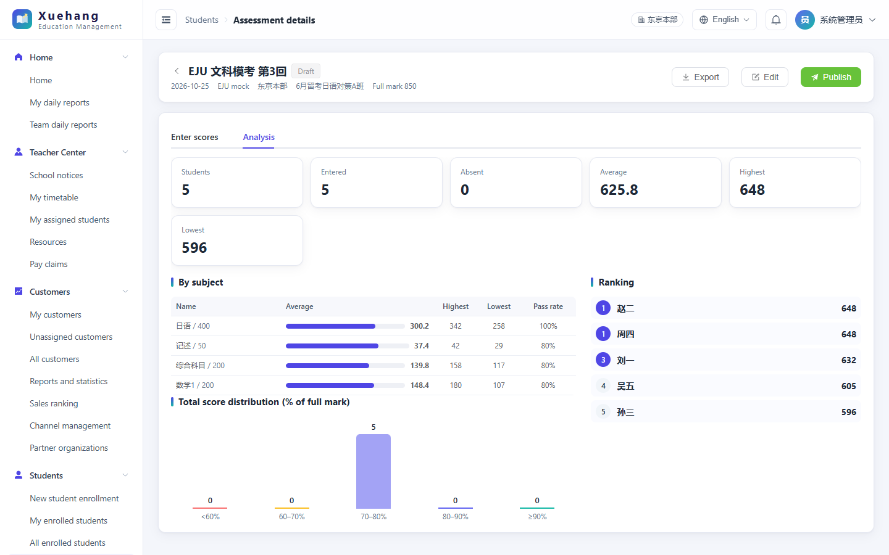

## Highlights

- **Industry presets.** Four presets ship with the system: Japan exam-prep school, China K-12 tutoring center, language school, and a minimal general training center. Pick one during installation and re-import or switch at any time.
- **Grade management.** Create quizzes, monthly or mock exams, mid-terms, and finals from subject templates, then enter scores in a grid or paste them from Excel. Totals are calculated automatically (sum, average, or manual entry) and students are ranked. Each assessment shows per-subject averages, pass rates, and a score distribution, exports to Excel, and can be published to the student portal. Student pages include a trend chart.
- **Configurable exam records.** Student profiles can record any exam or certificate, with its own levels, full marks, subject scores, number of attempts, and fixed exam months. Examples: JLPT, EJU, IELTS (band average), TOEFL, Zhongkao, Gaokao, CET.
- **Configurable profile fields.** Show, hide, require, or rename each student profile field to match your institution, for example "Highest qualification" → "Grade".
- **From lead to enrolled student.** Customer follow-up, a shared lead pool, enrollment, packages, and payment and refund records connect end to end.
- **Unified room scheduling.** Group lessons, one-to-one (VIP) lessons, and other bookings share one timetable. Room, teacher, and student conflicts are detected, and batch scheduling works by date range and weekday.
- **Lesson-hour ledger.** One-to-one hours are tracked as total, confirmed, pending, and remaining. Students can confirm lessons themselves, and optional auto-confirmation runs after each lesson.
- **Student services.** Attendance, consultation and interview booking, document review, printing quotes, notices, and shared files.
- **Role-based access.** Permissions work together with own / campus / all data scopes, and payroll review scopes can be set per reviewer.
- **Student timetable.** The student portal shows group classes and one-to-one lessons together in a week / month calendar, with room, teacher, attendance and lesson notes; finished one-to-one lessons can be confirmed right there.
- **Two portals, eight languages, mobile ready.** Staff and students have separate portals, with responsive layouts and eight interface languages.
- **Flexible deployment.** Runs on SQLite, MySQL / MariaDB, or PostgreSQL, with a browser-based first-run installer. SMTP email covers notification emails and password recovery.

## Screenshots

| Room board | Grade entry |
|---|---|
| 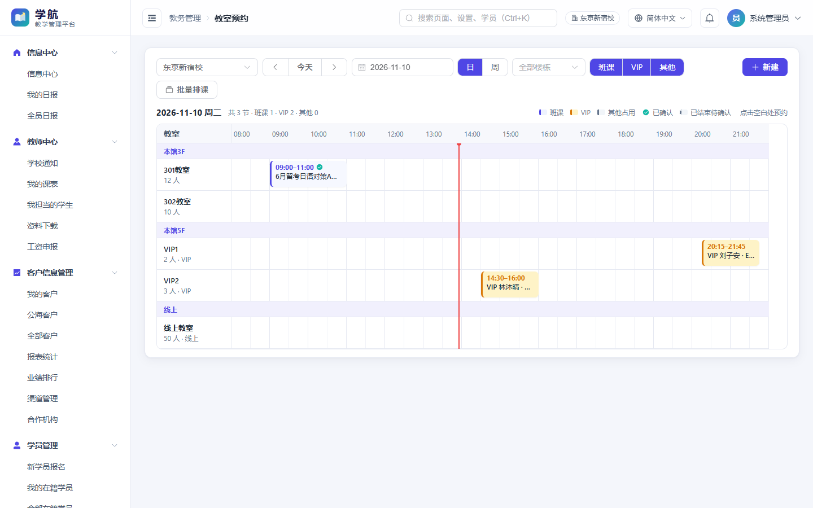 | 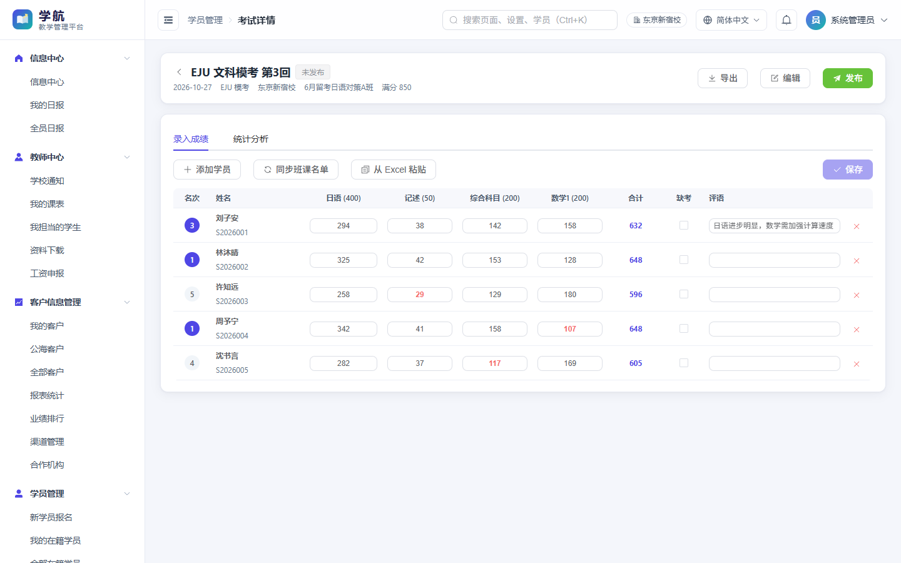 |

| Student score trend | Configurable exam records |
|---|---|
| 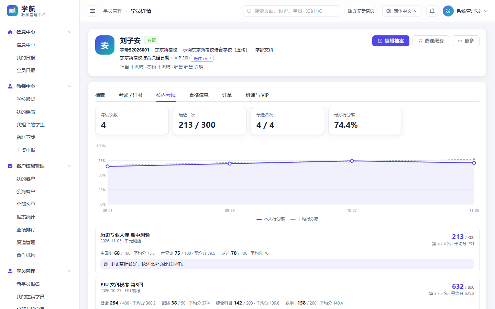 | 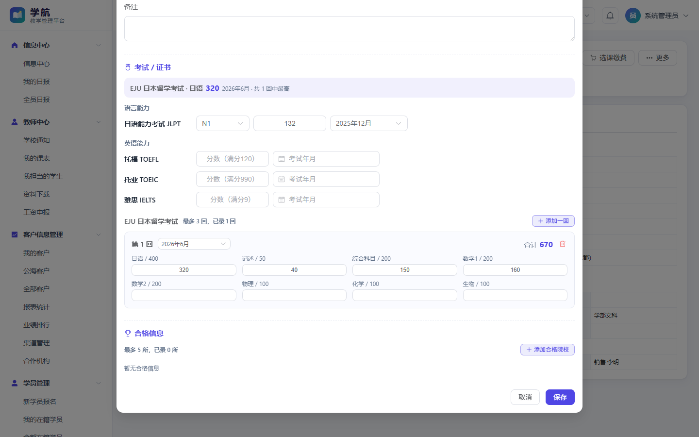 |

| Industry presets (Japanese UI) | Exam type settings |
|---|---|
| 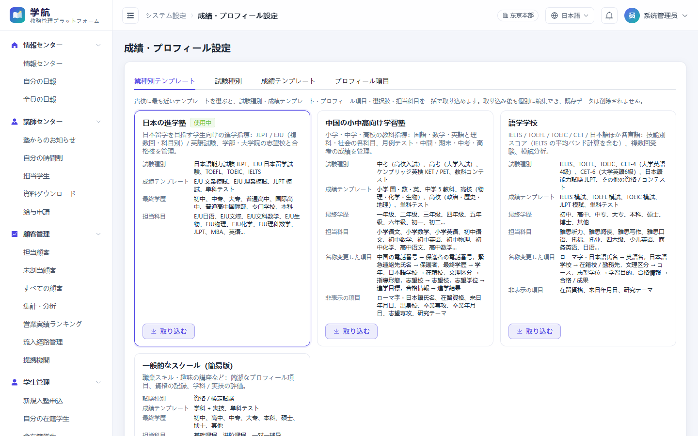 | 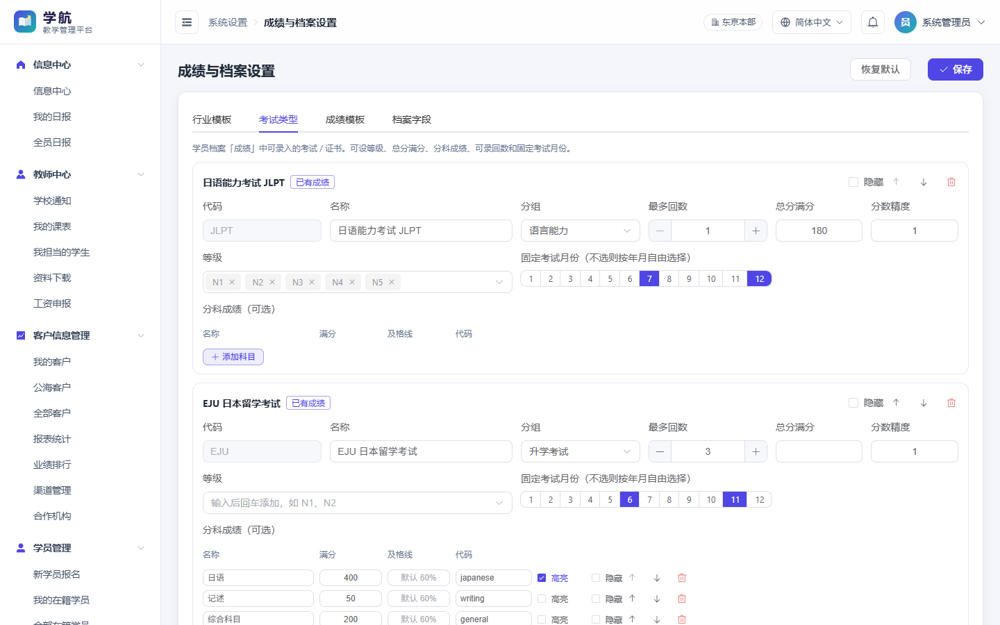 |

| CRM | Student timetable (group + one-to-one) |
|---|---|
| 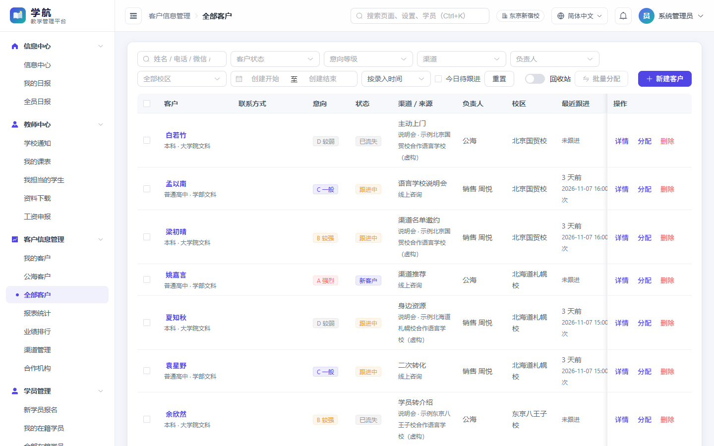 | 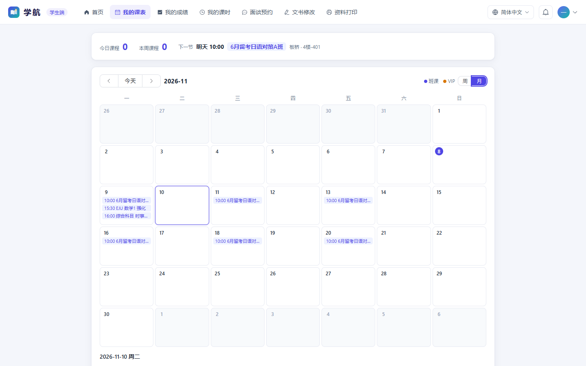 |

<p align="center">
  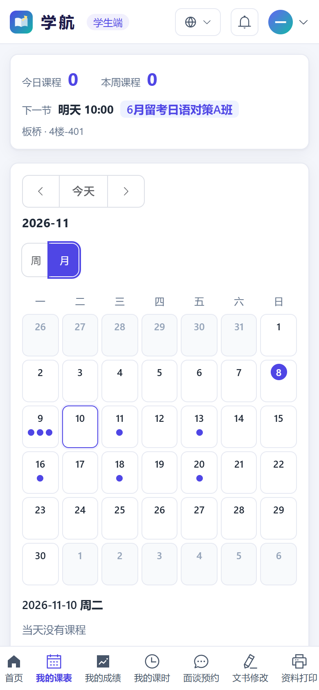
  &nbsp;&nbsp;
  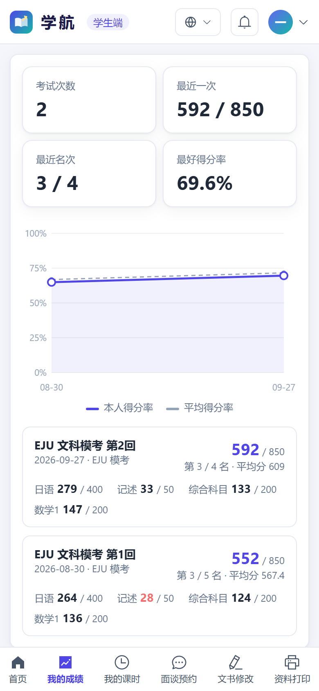
  &nbsp;&nbsp;
  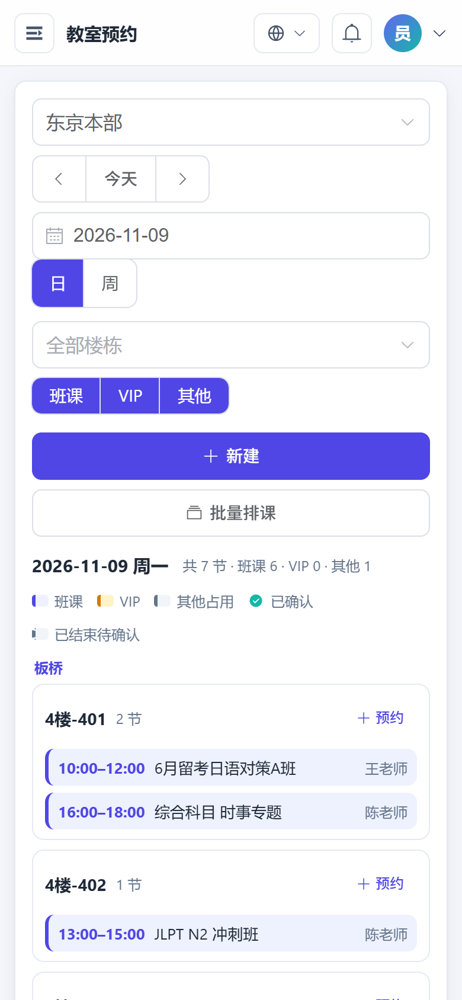
</p>

## Modules

| Module | Main functions |
|---|---|
| Information center | Recent notices and files, role-dependent tasks, today's lessons and consultations, personal and staff daily reports |
| CRM | My customers, shared pool, all customers, follow-ups, channels, partner organizations, reports, rankings |
| Students | Enrollment, own/all students, profiles, exams & certificates, admissions, **grade management**, orders, payments, refunds, courses and packages |
| Academic administration | Room board, timetable, monthly schedule, batch scheduling, one-to-one packages, group classes, rooms |
| Teacher center | School notices, my schedule, assigned students, lesson records, downloads, wage claims |
| Teaching services | Attendance, consultation and interview bookings and records, document review, printing, notices, shared files |
| HR | Wage claim review, per-person summaries, Excel export, reviewer scopes |
| System settings | Site branding and texts, business rules and dropdowns, **grades & profile settings** (presets / exam types / grade templates / profile fields), email, staff accounts, roles, campuses, subjects, audit log |
| Student portal | Home, **my timetable** (group + one-to-one, week / month), **my grades**, lesson hours, bookings, document review, printing, notices, downloads |

## Industry presets

| Preset | Exams & certificates | Grade templates | Profile adjustments |
|---|---|---|---|
| Japan exam-prep school (default) | JLPT, EJU (3 sittings, 8 subjects), TOEFL, TOEIC, IELTS | EJU humanities / sciences mock, JLPT mock, single-subject quiz | Full admissions profile |
| China K-12 tutoring center | Zhongkao, Gaokao, Cambridge English, competitions | Primary 3 subjects, junior high 5 subjects, senior high (sciences / humanities) | "Grade" and "Current school" fields; visa and arrival fields hidden |
| Language school | IELTS (band average), TOEFL, TOEIC, CET-4/6, JLPT with sections | IELTS / TOEFL / TOEIC / JLPT mocks | "English name", course track, learning goal |
| General training center (minimal) | Certificates / level exams | Theory + practical, single-subject quiz | Lean profile |

Importing never deletes data. Exam types already used by student records are kept but hidden, existing dropdown options are kept but hidden, and teaching subjects are only ever added.

## Tech stack

Node.js 22+ (24 recommended), npm workspaces, TypeScript · Fastify 5, Prisma 7, Zod 4, JWT, bcrypt, Nodemailer · SQLite / MySQL / MariaDB / PostgreSQL · Vue 3, Vite 8, Element Plus, Pinia, vue-i18n 11 · ExcelJS.

## Quick start

**First-run installer (recommended):**

```bash
npm install
npm run dev:server   # terminal 1: backend (install mode when no database is configured)
npm run dev:web      # terminal 2: frontend
```

If `DATABASE_URL` is not set, the backend starts in install mode. Open `http://localhost:5173` and enter the install code, which is printed in the console and also saved to `server/.install-token`. The wizard then walks you through choosing a database, setting up the site and campus, picking an **industry preset**, and creating the administrator. For production, build the frontend (`cd web && npm run build`) and serve it behind a reverse proxy such as Nginx; see the [deployment guide](docs/部署指南.md).

**Local development with demo data:** copy `server/.env.example` to `server/.env`, set a random `JWT_SECRET`, then:

```bash
npm run db:generate -w server
cd server && npx prisma db push && npm run db:seed && cd ..
```

```bash
npm run dev:server
```

```bash
npm run dev:web
```

Staff portal: `http://localhost:5173/`; student portal: `http://localhost:5173/portal`. Demo logins are `admin` / `admin123`, staff `jw01`, `sales01`, `t01`–`t04`, `sw01` / `123456`, and students `S2026001`–`S2026006` / `123456`. These accounts exist only in the local demo database.

## Languages

Simplified Chinese, English, Japanese, French, Spanish, Russian, Portuguese (Brazil), and German. Built-in preset names (exams, subjects, options) are translated. Names you type yourself and other business content are not.

## Security

Passwords are hashed, failed logins are rate-limited, and JWT authentication is used. Every API checks permissions, uploads are validated by type and file signature, uploaded files require login to access, and operations are logged. Before going live, read the [security notes](docs/安全说明.md).

## License

[Apache License 2.0](LICENSE). See [NOTICE](NOTICE) for copyright and third-party notes.

## Feedback & support

- Feature requests and bug reports: please [open an issue](https://github.com/MRTangwin8/XueHang/issues).
- Deployment help: email [mrtangwin8@gmail.com](mailto:mrtangwin8@gmail.com).
